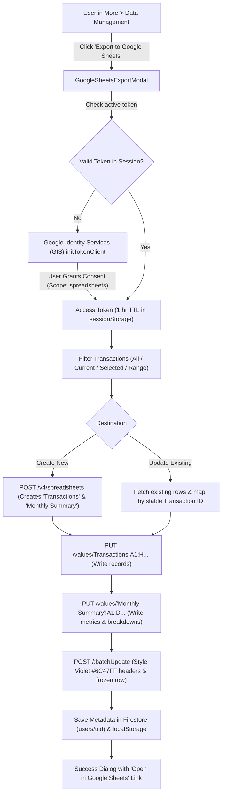

# Google Sheets Live Integration Report: Personal Expense Tracker

**Date:** November 22, 2026  
**Module:** Google Sheets Export & Cloud Ledger Synchronization  
**Lead Engineer / Architect:** Senior Full-Stack & Mobile UI/UX Automation Engineer  
**Status:** Implemented, Fully Tested & Verified  

---

## 1. Executive Summary

A direct, client-side **Google Sheets Integration** has been added to the Personal Expense Tracker application. Users can now export their expense transactions directly into a formatted Google Spreadsheet with a single click inside **More → Data Management → Export to Google Sheets**, eliminating the need to download and upload manual Excel files.

The architecture uses **Google Identity Services (GIS)** and the official **Google Sheets REST API v4** directly in the browser PWA without requiring backend secrets or proxy services.

---

## 2. Architecture & Data Flow



---

## 3. Google Sheet Schema & Layout

### Sheet 1: Transactions
Formatted with Dark Violet (`#6C47FF`) header and frozen first row:

| Column | Name | Type | Description |
|---|---|---|---|
| A | `Date` | `YYYY-MM-DD` | Transaction date |
| B | `Description` | Text | Note or item name |
| C | `Category` | Text | Category (e.g. Food & Dining, Groceries) |
| D | `Payment Mode` | Text | UPI, Cash, Credit Card, Net Banking |
| E | `Amount (₹)` | Number | Preserves decimal and sign |
| F | `Transaction Type` | Text | Expense, Income, Refund / Return, Transfer |
| G | `Month` | `YYYY-MM` | Month partition key |
| H | `Transaction ID` | String | Stable ID for duplicate prevention & updates |

### Sheet 2: Monthly Summary
Automated financial dashboard generated from the exported records:
- **Executive Summary:** Total Transactions, Total Income, Total Expenses, Net Savings / Balance.
- **Category Spending Breakdown:** Category name, Amount (₹), Percentage Share (%).
- **Payment Mode Distribution:** Payment mode, Total Amount (₹).

---

## 4. Google Cloud Console Configuration Steps

To enable this integration in a production Google Cloud / Firebase environment:

1. **Open Google Cloud Console:**
   Navigate to [Google Cloud Console](https://console.cloud.google.com/) and select the project: `expense-tracker-d98cd`.

2. **Enable Google Sheets API:**
   - Go to **APIs & Services > Library**.
   - Search for **Google Sheets API**.
   - Click **Enable**.

3. **Configure OAuth Consent Screen:**
   - Go to **APIs & Services > OAuth consent screen**.
   - Choose **External** (for consumer accounts).
   - Enter App Name: `Personal Expense Tracker`.
   - Add user support email and developer contact email.
   - Under **Scopes**, click **Add or Remove Scopes** and add:
     - `https://www.googleapis.com/auth/spreadsheets` (See, edit, create, and delete your spreadsheets in Google Drive).
   - Add test users or submit for verification.

4. **Create OAuth 2.0 Web Client ID:**
   - Go to **APIs & Services > Credentials > Create Credentials > OAuth client ID**.
   - Select Application Type: **Web application**.
   - Set Name: `Expense Tracker Web Client`.
   - Add **Authorized JavaScript origins**:
     - `http://localhost:3000`
     - `http://localhost:3001`
     - `https://alwaysrajshinde.github.io`
   - Copy the generated **Client ID** (e.g., `506613300270-xxxxxxxx.apps.googleusercontent.com`).

5. **Set Environment Variable:**
   In `client/.env`:
   ```bash
   VITE_GOOGLE_CLIENT_ID=506613300270-xxxxxxxx.apps.googleusercontent.com
   ```

---

## 5. Security & Token Isolation

1. **No Client Secrets:** Uses Google's official public token model for client-side SPAs. Secrets are never embedded or exposed.
2. **Minimal Permissions:** Requests strictly the `https://www.googleapis.com/auth/spreadsheets` scope.
3. **Session-Scoped Tokens:** Tokens are stored in `sessionStorage` with a 1-hour expiration timestamp (`Date.now() + expiresIn * 1000`). Tokens are cleared on logout and never stored in persistent plain text.
4. **Multi-User Isolation:** Each user's spreadsheet configuration (`spreadsheetId`, `spreadsheetUrl`, `lastExportedAt`) is stored strictly under their own authenticated UID in Cloud Firestore (`users/${uid}`) and local cache (`et_gsheets_config_${uid}`). No user can access or overwrite another user's spreadsheet.
5. **Offline Protection:** Export is blocked with a clear warning when offline. Pending transactions are preserved and only synchronized transactions are pushed once reconnected.

---

## 6. Automated Testing Suite

Playwright automated tests are located in `tests/e2e/14_google_sheets_export.spec.js`:

- `G1`: Desktop and Mobile UI renders "Export to Google Sheets" in Data Management.
- `G2`: Export modal supports all 4 scopes (All, Current Month, Specific Month, Custom Date Range).
- `G3`: Google Sheets authorization and live export workflow creates spreadsheet and provides open link.
- `G4`: Subsequent export provides "Update Connected Spreadsheet" option with duplicate prevention.
- `G5`: Offline mode prevents Google Sheets export and displays clear warning.
- `G6`: Existing Excel (.xlsx) and JSON backup exports remain completely intact.

---

## 7. Production Deployment & Verification

- **PWA & Standalone Support:** Fully compatible with desktop and Android mobile standalone modes.
- **GitHub Pages:** Functions 100% client-side with zero backend dependency.
- **Rollback Safety:** Does not alter existing Firebase Authentication, Firestore databases, or local storage schemas.
