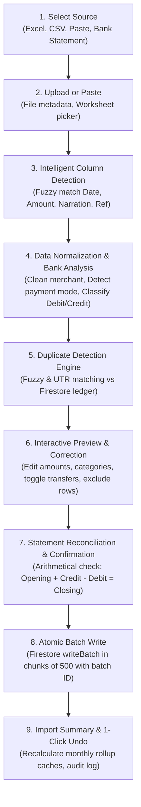
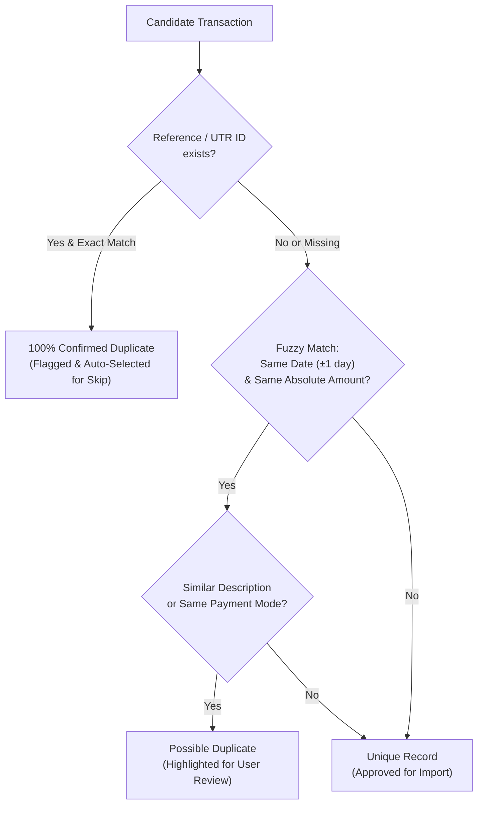

# Technical Design Document: Intelligent Expense Import System

**Project:** Personal Expense Tracker  
**Document Version:** 1.0.0  
**Date:** November 21, 2026  
**Status:** Approved for Implementation (Branch: `feature/intelligent-import-system`)  
**Target Environments:** GitHub Pages (Static Client with Firebase Cloud Firestore) & Local Node.js / SQLite  

---

## 1. Feature Overview & Architecture

The **Intelligent Expense Import System** transforms raw, unstructured, or semi-structured financial documents (Excel workbooks, CSV files, clipboard text, and downloaded bank statements) into verified, categorized, and reconciled ledger transactions.

### Key Architectural Tenets
1. **Zero-Server / Privacy-First Processing:**  
   All file parsing, bank format recognition, narration classification, and duplicate detection happen entirely **client-side** in the user's browser. Sensitive banking files and financial records are **never** transmitted to third-party parsing servers or external AI APIs.
2. **Single Transaction Schema & Unified Engine:**  
   Imported records are normalized to the exact same Firestore schema (`users/{uid}/transactions/{txId}`) used by manually added expenses. Financial metrics across Dashboard, Reports, and Settings calculate identically without dual pipelines.
3. **Deterministic Financial Protection:**  
   Refunds, reversals, bank charges, and internal transfers between the user's own accounts are explicitly classified. Internal self-transfers are prevented from inflating monthly spending or income metrics.
4. **Idempotency & Safe Undo:**  
   Every import generates a discrete `import_batch_id`. The user can undo an import in 1 click, which purges only the records associated with that batch while invalidating affected monthly rollup caches without touching existing ledger records.

---

## 2. Supported Sources & Formats

| Source | File Extensions / Inputs | Processing Engine | Capabilities | Status |
|---|---|---|---|---|
| **Excel Workbooks** | `.xlsx`, `.xls` | SheetJS (`xlsx` v0.20.3) | Multi-worksheet selection, formula evaluation, numeric date parsing, empty row skipping. | **Implemented** |
| **CSV Files** | `.csv`, `.txt` | Custom Delimiter Auto-Detector + SheetJS | Comma (`,`), Semicolon (`;`), Tab (`\t`), and Pipe (`\|`) auto-detection, quote escaping. | **Implemented** |
| **Direct Clipboard Paste** | Raw text from Excel, Google Sheets, Web | Tab/Comma text matrix tokenizer | 1-click paste from spreadsheet clipboard, auto-header detection, real-time preview. | **Implemented** |
| **Bank Statements (Text/Excel/CSV)** | `.csv`, `.xlsx`, `.xls`, `.txt` | Dedicated Bank Rule & Regex Matrix | SBI, HDFC Bank, ICICI Bank, Axis Bank, Kotak Mahindra Bank, and Generic statements. | **Implemented** |
| **Bank Statements (PDF / Scanned OCR)** | `.pdf`, `.png`, `.jpg` | Optional Client OCR / PDF.js | Text layer extraction for selectable PDFs; OCR fallback for scanned receipts. | *Planned for v2.0* |

---

## 3. Step-by-Step Import Workflow



### Detailed Wizard Steps:
- **Step 1: Choose Import Source & Account:** User selects file type and optionally selects or registers a bank account nickname (e.g. `HDFC Salary A/c - XX4092`).
- **Step 2: Upload / Paste:** Drag & drop file or paste text; SheetJS reads workbook headers and sheets.
- **Step 3: Column Mapping:** System auto-detects header row, skips metadata rows, and maps columns with an interactive dropdown override interface.
- **Step 4: Classification & Merchant Analysis:**
  - Extracts clean merchant names from messy strings (e.g., `UPI/P2A/12345/AMAZON` → `Amazon`).
  - Suggests categories (e.g., `Shopping`) and payment modes (`UPI`).
  - Identifies refunds (`REFUND/SWIGGY` → `is_refund: true`).
  - Identifies internal transfers (`TFR TO XX4092` → `type: 'transfer'`).
- **Step 5: Duplicate Review:** Compares parsed records against the user's historical transactions by date, amount, reference number, and description.
- **Step 6: Preview Table:** Interactive spreadsheet grid with inline editing, batch category assignments, and row toggles.
- **Step 7: Final Confirmation:** Summarizes total expense, income, refunds, transfers, and arithmetic balance reconciliation.
- **Step 8: Execution & Progress:** Batched writes (500 docs per chunk) with live percentage progress.
- **Step 9: Result & History:** Success/failure report with error log download and 1-click Undo.

---

## 4. Intelligent Column Detection & Mapping Strategy

The mapper uses case-insensitive regex pattern scoring to identify fields regardless of header naming conventions:

| Target Field | High-Confidence Header Patterns |
|---|---|
| **Date** | `date`, `tx_date`, `transaction date`, `txn date`, `value date`, `posting date`, `booking date`, `expense date` |
| **Description** | `narration`, `particulars`, `description`, `details`, `remarks`, `transaction remarks`, `payee`, `merchant` |
| **Amount (Single)** | `amount`, `transaction amount`, `txn amount`, `net amount`, `expense`, `value`, `total` |
| **Debit** | `debit`, `withdrawal`, `dr`, `dr amount`, `withdrawal amount`, `debit amount`, `spent` |
| **Credit** | `credit`, `deposit`, `cr`, `cr amount`, `deposit amount`, `received`, `refund` |
| **Category** | `category`, `expense category`, `type`, `expense type`, `head`, `tag` |
| **Payment Mode** | `mode`, `payment mode`, `payment method`, `instrument`, `channel`, `type`, `txn type` |
| **Reference / UTR** | `ref no`, `reference`, `reference id`, `utr`, `utr number`, `chq no`, `cheque no`, `txn id`, `transaction id` |
| **Balance** | `balance`, `running balance`, `closing balance`, `available balance`, `account balance` |

If a file has **no headers**, the system analyzes the first 5 data rows using data-type heuristics:
- Dates matching `DD/MM/YYYY`, `YYYY-MM-DD`, or Excel date numbers.
- Currency numbers containing digits, commas, or currency glyphs (`₹`, `$`, `Rs`).
- String text columns for narration/description.

---

## 5. Bank Statement Processing & Narration Analysis

### 5.1. Bank Recognition Matrix
Signatures detected in document headers or column structures:
- **State Bank of India (SBI):** Headers `Txn Date`, `Value Date`, `Description`, `Ref No./Cheque No.`, `Debit`, `Credit`, `Balance`.
- **HDFC Bank:** Headers `Date`, `Narration`, `Chq/Ref No`, `Value Dt`, `Withdrawal Amt.`, `Deposit Amt.`, `Closing Balance`.
- **ICICI Bank:** Headers `Transaction Date`, `Value Date`, `Cheque Number`, `Transaction Remarks`, `Withdrawal Amount (INR )`, `Deposit Amount (INR )`, `Balance (INR )`.
- **Axis Bank:** Headers `Tran Date`, `CHQNO`, `PARTICULARS`, `DR`, `CR`, `BAL`, `SOL`.
- **Kotak Mahindra Bank:** Headers `Sl. No.`, `Transaction Date`, `Value Date`, `Description`, `Chq / Ref No.`, `Dr / Cr`, `Amount`, `Balance`.

### 5.2. Narration Parsing Engine
Bank statements obscure merchant details behind technical routing prefixes. The regex classifier extracts clean labels and suggests categories:

```javascript
// Examples of Narration Normalization Rules:
"UPI/P2A/123456789/AMAZON PAY"       -> Merchant: "Amazon Pay", Mode: "UPI", Category: "Shopping"
"POS/RELIANCE FRESH/MUMBAI/4092"     -> Merchant: "Reliance Fresh", Mode: "Card", Category: "Groceries"
"NEFT/N12345/SWIGGY/FOOD DELIVERY"   -> Merchant: "Swiggy", Mode: "Net Banking", Category: "Food & Dining"
"ATM-WDL/CASH/S1AB0123/PUNE"         -> Merchant: "ATM Cash Withdrawal", Mode: "Cash", Category: "Other"
"ACH/D/HDFC001/HOME LOAN EMI"        -> Merchant: "Home Loan EMI", Mode: "Net Banking", Category: "EMI & Loans"
"INT.PD:01-07-2026 TO 30-09-2026"    -> Merchant: "Bank Interest Credit", Mode: "Net Banking", Type: "income"
"REFUND/REV/UBER TRIP"               -> Merchant: "Uber", Mode: "UPI", Category: "Transportation", Type: "refund"
```

---

## 6. Duplicate Detection Algorithm

To prevent double-counting when overlapping statement ranges or multiple files are imported, each candidate transaction is evaluated against existing Firestore records:



- **Confirmed Duplicate:** Exact match on `reference_id` (UTR / Cheque ID). Default action: **Skip**.
- **Possible Duplicate:** Matching date (within 24 hours) + exact amount + matching mode/description. Default action: **User Review Required**.
- **Unique Record:** No collision. Default action: **Import**.

---

## 7. Data Validation & Database Schema

### 7.1. Firestore Document Schema (`users/{uid}/transactions/{id}`)
```typescript
interface LedgerTransaction {
  id: string;                         // Auto-generated Firestore Document ID
  user_id?: string;                   // Authenticated Firebase UID
  date: string;                       // Normalized 'YYYY-MM-DD'
  month_key: string;                  // 'YYYY-MM'
  amount: number;                     // Float (always positive, sign indicated by type/refund)
  description: string;                // Clean merchant or cleaned description
  category: string;                   // Valid category from user's category list
  payment_mode: string;               // Normalized (UPI, Cash, Credit Card, Debit Card, Net Banking, EMI)
  is_refund: boolean;                 // True if transaction is a refund/credit reversal
  type?: 'expense' | 'income' | 'refund' | 'transfer'; // Financial classification
  is_transfer?: boolean;              // True if internal self-transfer (excluded from expense rollups)
  reference_id?: string;              // UTR, Cheque number, or bank transaction ID
  raw_narration?: string;             // Original unedited bank narration text
  bank_account?: string;              // Nickname or masked account ID (e.g., 'HDFC-XX4092')
  import_batch_id?: string;           // UUID of the import batch for 1-click Undo
  created_at: any;                    // Firestore serverTimestamp()
  updated_at?: any;
}
```

### 7.2. Import Batch Audit Log (`users/{uid}/import_batches/{batchId}`)
```typescript
interface ImportBatchLog {
  id: string;                         // Unique Batch UUID
  user_id: string;
  source: 'excel' | 'csv' | 'paste' | 'bank_statement';
  filename: string;
  bank_name?: string;
  account_nickname?: string;
  total_detected: number;
  imported_count: number;
  skipped_count: number;
  total_expense: number;
  total_income: number;
  date_range: { start: string; end: string };
  transaction_ids: string[];          // IDs of all documents written in this batch
  undone: boolean;                    // True if batch was subsequently reverted
  created_at: string;
}
```

---

## 8. Performance, Scalability & Limits

1. **Memory & Parsing Limits:** Tested up to 5,000 transactions (approx. 5MB CSV/Excel). Browser UI remains responsive through asynchronous chunking and non-blocking Web Worker/Promise execution.
2. **Firestore Rate & Batch Safety:** Written via `writeBatch()` in chunks of **400 documents** (well below Firestore's 500-write limit per batch).
3. **Monthly Cache Reconciliation:** After batch commit, invalidates affected `users/{uid}/months/{monthKey}` documents so subsequent dashboard and report loads reflect fresh totals without full database scans.

---

## 9. Security & Privacy Commitments

1. **Client-Side Sandbox:** Zero file uploads to unverified servers.
2. **PII Masking:** Full 16-digit debit/credit card numbers and 12-digit account numbers in narrations are masked to the last 4 digits (`XXXXXXXX4092`).
3. **Password Protection:** Encrypted or password-protected PDF/Excel bank statements trigger a clear error message explaining how to export an unencrypted format or enter the password locally in memory.

---

## 10. Implementation Deliverables

1. Engine Modules:
   - `client/src/services/import/fileParser.js`
   - `client/src/services/import/columnMapper.js`
   - `client/src/services/import/bankStatementDetector.js`
   - `client/src/services/import/narrationClassifier.js`
   - `client/src/services/import/duplicateDetector.js`
   - `client/src/services/import/importService.js`
2. UI Module:
   - `client/src/components/import/IntelligentImportModal.jsx`
   - `client/src/components/import/ImportHistoryModal.jsx`
3. Navigation Entry Points:
   - Sidebar: `Import / Export` tab in Windows Desktop.
   - Settings: `Import Expenses` button in Data Management.
   - Mobile: Action in Settings & Quick action launcher.
4. QA Automation:
   - `tests/e2e/05_intelligent_import.spec.js` (comprehensive Playwright test suite).
