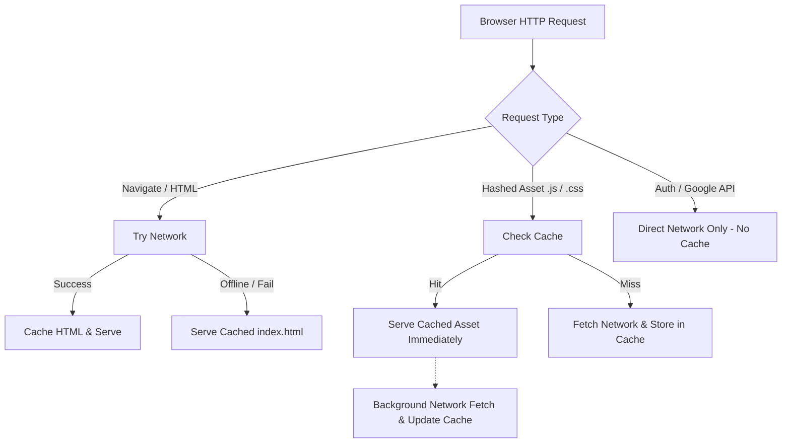

# Offline-First Architecture & Implementation Specification
**Personal Expense Tracker — Sovereign Offline-First Upgrade**
*Version: 2.0.0 · Status: Architectural Blueprint & Audit Complete*

---

## 1. Executive Summary

This document details the architectural design, audit findings, data isolation principles, and implementation roadmap to transform the **Personal Expense Tracker** into a complete **Offline-First Progressive Web Application (PWA)**. 

The application enables users to manage their personal finances seamlessly regardless of internet availability:
- **Instant offline launch**: The installed PWA loads the complete shell, CSS, and JavaScript bundles without an active network connection.
- **Full offline CRUD**: Users can add expenses, edit records, delete transactions, manage categories, and adjust monthly budgets with zero network latency.
- **Immediate local reactivity**: Dashboard totals, remaining budget ceilings, category breakdowns, and visual reports recalculate instantly from local data without waiting for network responses.
- **Guaranteed data integrity & synchronization**: Offline mutations are assigned deterministic, stable IDs and queued safely in local storage and Firestore's offline persistence layer, synchronizing automatically when connectivity returns.
- **Multi-user isolation**: Caches are strictly partitioned by authenticated Firebase `UID`, preventing data leakage across accounts or during logout/login workflows.
- **Zero-loss offline export**: Users can generate and download formatted Excel (`.xlsx`) and CSV files directly in browser memory without reaching external servers.

---

## 2. Phase 1 — Comprehensive Architecture Audit

### 2.1 Current Implementation State

| Area | Current Implementation | Offline Status | Audit Finding |
|---|---|---|---|
| **Hosting & Shell** | GitHub Pages (`https://alwaysrajshinde.github.io/Expense-Tracker/`) + Vite | Partial | Service worker (`public/sw.js`) precaches `index.html` and icons, but does not precache hashed Vite assets (`assets/index-*.js`, `assets/index-*.css`). Initial launch while offline fails if dynamic chunks are not pre-cached. |
| **Authentication** | Firebase Authentication (Email/Password + Google OAuth 2.0) | Online Only | Auth state is persisted in IndexedDB by Firebase SDK and mirrored in `localStorage.expense_tracker_auth_session`. Token refresh requires network, but cached user identity (`uid`, `email`) is available offline. |
| **Database Engine** | Cloud Firestore (`users/{uid}/transactions`, `users/{uid}/categories`, `users/{uid}/months/{monthKey}`) | Configured | `initializeFirestore` uses `persistentLocalCache({ tabManager: persistentMultipleTabManager() })`. Firestore SDK queues writes locally. However, when offline, queries across newly invalidated month summary documents fallback to null if not pre-cached. |
| **Local Cache Layer** | `localStorage` fallback in `client/src/services/api.js` | Disconnected | `saveLocalTransactions()` was only invoked in local REST API mode, leaving `localStorage` out-of-sync for cloud Firebase users. |
| **Calculation Engine** | `client/src/services/sheetsBackend.js` | 100% Client-Side | Pure deterministic JavaScript calculation functions (`computeDashboardFromTransactions`, `computeReportsFromTransactions`). Perfect for zero-latency local offline execution. |
| **Export Engine** | `client/src/services/exportService.js` (SheetJS / XLSX) | 100% Client-Side | Capable of client-side Excel/CSV generation; however, settings export was called with empty array parameters. |
| **Sync Indicators** | None | Missing | No UI visibility into online/offline status, pending write queues, or sync failures. |

---

## 3. Phase 2 — PWA Offline Support & Cache Strategy

### 3.1 Service Worker Architecture (`public/sw.js`)

To ensure the application launches reliably in standalone mode and in offline browsers, the service worker utilizes a hybrid caching strategy:

1. **Precache App Shell**: Pre-caches the core entry points:
   - `./` (Root document)
   - `./index.html`
   - `./manifest.json`
   - `./icon.svg`, `./icon-192.png`, `./icon-512.png`
2. **Dynamic Asset Caching (Cache-First with Network Revalidation)**:
   - Intercepts all requests to `./assets/*.js`, `./assets/*.css`, and fonts.
   - Serves immediately from `CACHE_NAME` (`expense-tracker-v3`).
   - Asynchronously fetches updated assets from the network to keep cache fresh without blocking startup.
3. **Navigation Fallback (Network-First with Offline Shell Fallback)**:
   - For all HTML navigation requests (`request.mode === 'navigate'`), attempts network fetch; if network fails (offline), serves cached `./index.html`.
4. **Security Isolation**:
   - Explicitly rejects caching for OAuth tokens, Google GIS identity endpoints (`accounts.google.com`, `googleapis.com`), and Firebase auth tokens.



---

## 4. Phase 3 — Firestore Offline Persistence & Dual-Tier Local Storage

### 4.1 Tier 1: Cloud Firestore Persistent Local Cache

Firebase Firestore is initialized with multi-tab IndexedDB persistence:
```javascript
db = initializeFirestore(app, {
  localCache: persistentLocalCache({
    tabManager: persistentMultipleTabManager()
  })
});
```

### 4.2 Tier 2: Resilient User-Isolated Local Storage Ledger

To overcome Firestore's query-read latency when offline and prevent empty states when monthly roll-up documents (`users/{uid}/months/{monthKey}`) are invalidated, the application maintains a synchronous, user-partitioned local storage ledger:
- Storage Key: `et_ledger_${user_uid}`
- Storage Structure:
  ```json
  {
    "transactions": [...],
    "categories": [...],
    "settings": { "monthly_budget": 12000, "currency": "₹" },
    "pending_sync": [
      {
        "id": "tx_1732200000_abc",
        "action": "create",
        "payload": { ... },
        "timestamp": "2026-11-21T16:00:00.000Z"
      }
    ],
    "last_synced_at": "2026-11-21T15:55:00.000Z"
  }
  ```

---

## 5. Phase 4 — Offline Expense Management Workflows

### 5.1 Adding an Expense (Offline Workflow)
1. User enters amount, category, payment mode, description, and date in `AddExpenseModal`.
2. Generate deterministic, stable UUID: `tx_${Date.now()}_${Math.random().toString(36).substr(2, 9)}`.
3. Construct transaction object:
   ```javascript
   const newTx = {
     id: txId,
     date: parsedDate,
     month_key: parsedDate.slice(0, 7),
     amount: isRefund ? -Math.abs(amt) : Math.abs(amt),
     category,
     payment_mode,
     description,
     is_refund: Boolean(isRefund),
     sync_status: 'pending',
     created_at: new Date().toISOString(),
     updated_at: new Date().toISOString()
   };
   ```
4. Save to `et_ledger_${uid}`.
5. If Firestore is configured, invoke `setDoc(doc(db, 'users', uid, 'transactions', txId), newTx)`. Firestore queues the write in IndexedDB.
6. Recompute Dashboard and Reports locally via `computeDashboardFromTransactions()` in memory.
7. Update UI immediately — zero loading spinners, zero blocking alerts.
8. Set sync indicator to: **"Offline · 1 change waiting to sync"**.

### 5.2 Editing a Transaction (Offline Workflow)
1. User modifies description, amount, or category.
2. Update local record with `updated_at = new Date().toISOString()`, `sync_status = 'pending'`.
3. Recalculate monthly totals and budget remaining immediately.
4. Queue update in Firestore via `updateDoc`.

### 5.3 Deleting a Transaction (Offline Workflow)
1. User confirms deletion.
2. Remove from local active records immediately.
3. Append deletion marker to pending queue: `{ id: txId, action: 'delete', timestamp: ... }`.
4. Queue deletion in Firestore via `deleteDoc`.

---

## 6. Phase 5 — Offline Calculations & Reports

The calculation engine (`sheetsBackend.js`) runs 100% in client-side JavaScript memory:
- **Monthly Totals**: Sums all non-transfer, non-income transactions where `month_key === selectedMonth`.
- **Refunds & Negative Amounts**: Accurately subtracts refunds (`amount < 0` or `is_refund: true`) from total expense spent.
- **Budget Tracking**:
  $$\text{Remaining Budget} = \max(0, \text{Target Budget} - \text{Total Spent})$$
  $$\text{Spent Percentage} = \min\left(100, \text{round}\left(\frac{\text{Total Spent}}{\text{Target Budget}} \times 100\right)\right)$$
- **Zero Misinterpretation Prevention**: If offline and no transactions exist for an unvisited historical month, display clean empty state: *"No transactions cached for this month"* rather than misleading zero metrics.

---

## 7. Phase 6 — Synchronization Engine & Conflict Policy

### 7.1 Sync Engine Trigger Points
The sync engine activates automatically upon:
1. `window.addEventListener('online', triggerSync)` event.
2. Visibility change (`document.visibilityState === 'visible'`).
3. App foregrounding / resume.
4. User taps the synchronization status pill in the UI.

### 7.2 Conflict Resolution Policy
- **Strategy**: Last-Write-Wins with Deterministic Timestamp Priority (LWW-TP).
- **Rule**: If the same transaction document is edited on multiple devices, the edit with the later ISO timestamp (`updated_at`) prevails.
- **Safety**: Deletions take precedence over edits made prior to the deletion timestamp.
- **No In-Flight Duplication**: Stable, client-assigned IDs guarantee that retrying writes never creates duplicate records in Firestore.

---

## 8. Phase 7 — User Interface Status Indicators

A non-intrusive status pill is mounted in the global application header and mobile navigation:

| Network State | Sync State | Visual Indicator | Status Label |
|---|---|---|---|
| Online | Synced | 🟢 Green Dot | `Online · Synced` |
| Online | In Progress | 🟣 Purple Spinner | `Syncing 3 changes...` |
| Offline | Clean | 🟡 Amber Cloud | `Offline · Ready` |
| Offline | Pending Writes | 🟡 Amber Clock | `Offline · 2 changes saved` |
| Online | Error / Retry | 🔴 Red Alert | `Sync failed · Tap to retry` |

---

## 9. Phase 8 — Multi-User Security & Account Isolation

1. **Local Storage Key Scoping**:
   All offline keys are strictly prefixed by authenticated Firebase `uid`:
   - `et_ledger_${uid}`
   - `et_categories_${uid}`
   - `et_settings_${uid}`
2. **Logout Guard**:
   Before logging out, the application checks `pending_sync.length`:
   - If pending writes exist:
     *"You have 2 unsynchronized changes on this device. If you log out now before connecting to the internet, these changes cannot sync to your account. Are you sure you want to log out?"*
   - Options: `Wait for Sync` or `Discard & Log Out`.
3. **No Credential Storage**:
   No passwords or authentication secrets are ever stored in `localStorage` or IndexedDB.

---

## 10. Phase 9 — Offline Export Engine

- Excel (`.xlsx`) and CSV exports use `xlsx` (SheetJS) entirely in browser memory.
- If offline, exports all locally cached transactions with an informative toast:
  *"Exported 150 locally available records to Daily_Expenses_Export.xlsx"*
- Negative amounts and refund tags are strictly preserved in exported spreadsheets.
