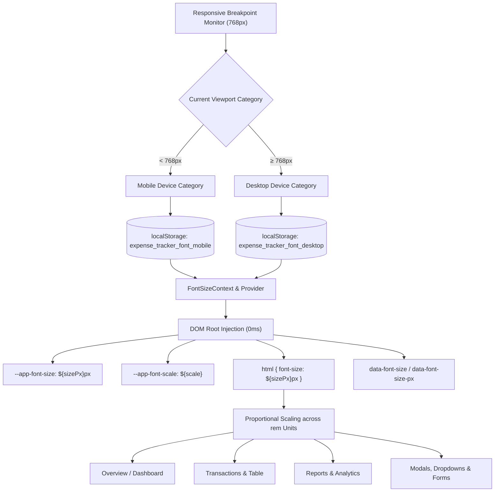

# QA Report: Application-Wide Custom Font Size & Device-Specific Preferences

**Date:** 23 November 2026  
**Status:** ✅ Fully Implemented, Verified, & Passed  
**Release Tag:** `v2.4.3`  
**Test Suite:** `tests/e2e/24_font_size_customization_audit.spec.js` (12/12 Passed) & `tests/e2e/23_more_search_deep_audit.spec.js` (14/14 Passed)

---

## 1. Overview & Objectives

The **Application-Wide Custom Font Size** feature provides complete visual accessibility and text sizing control across all views, dialogs, forms, tables, and analytics in the Personal Expense Tracker. 

Crucially, **Mobile (<768px)** and **Windows / Desktop (≥768px)** preferences are stored strictly independently in browser/device local storage. A user setting Large text on their mobile device retains their separate Medium or custom preference when accessing the application on a desktop browser, and vice versa.

---

## 2. Architecture & Implementation Approach



### Key Technical Mechanisms

1. **Independent Device Storage**:
   - `expense_tracker_font_mobile` stores mobile configuration.
   - `expense_tracker_font_desktop` stores Windows/desktop configuration.
   - Zero Firebase synchronization is used, keeping device ergonomics localized and sovereign per screen factor.

2. **Proportional Typography Scaling**:
   - In Tailwind CSS v4, all standard typography classes (`text-xs`, `text-sm`, `text-base`, `text-lg`, `text-xl`, etc.) are computed in `rem` relative to the root `<html>` element.
   - Injecting `html { font-size: var(--app-font-size, 16px); }` proportionally scales text application-wide with mathematical consistency.
   - Arbitrary pixel utility classes (`text-[10px]`, `text-[11px]`, `text-[13px]`) are scaled proportionally via `.text-[10px] { font-size: calc(10px * var(--app-font-scale, 1)) !important; }`.
   - Vector icons retain their fixed `size` properties, preventing visual warping or distortion.

3. **Breakpoints & Viewport Detection**:
   - Standard boundary: `768px` (`(min-width: 768px)`).
   - Below `768px` evaluates to `'mobile'`.
   - At or above `768px` evaluates to `'desktop'`.
   - Native Capacitor wrapper fallback: `window.Capacitor?.isNativePlatform()` forces `'mobile'` on native Android builds.
   - Viewport resizing dynamically evaluates the incoming device category and applies its saved preference in real time without ever overwriting either stored setting.

---

## 3. Font Size Specifications & Storage Schema

### Option A: Preset Sizes

| Preset Key | Label | Root Size | Scale Factor | Best For |
| :--- | :--- | :--- | :--- | :--- |
| `small` | **Small** | `14px` | `0.875` | High information density, power users |
| `medium` | **Medium (Default)** | `16px` | `1.000` | Standard balanced readability |
| `large` | **Large** | `18px` | `1.125` | Enhanced comfort, relaxed reading |
| `extra-large` | **Extra Large** | `20px` | `1.250` | Maximum accessibility & prominent typography |

### Option B: Custom Size Range

- **Minimum Size:** `12px`
- **Maximum Size:** `24px`
- **Default Baseline:** `16px`
- **Step Increment:** `1px`
- **Indicator:** When in custom mode, the UI dynamically displays a purple badge: `Custom Active · {sizePx}px`, disambiguating from preset selections.

### JSON Storage Schema

```json
{
  "mode": "preset",
  "preset": "large",
  "sizePx": 18
}
```

```json
{
  "mode": "custom",
  "preset": null,
  "sizePx": 22
}
```

---

## 4. Settings UI & User Experience

- **Settings Path:** More → Appearance & Accessibility → App Font Size
- **Theme Consistency:** Follows the established Dark Violet aesthetic (`#0D0B18` background, `#16132A` surfaces, `#6C47FF` brand purple, `#C084FC` violet highlights).
- **Interactive Preset Grid:** 4 tactile cards with checkmark indicators.
- **Continuous Custom Slider:** Smooth HTML5 range slider with boundary markers and live pixel readout.
- **Live Typography Preview Box:** Real-time preview card rendering live headers, body copy, and sample financial transaction ledger items before leaving settings.
- **Reset to Default Button:** 1-click restore to 16px Medium.
- **Search Engine Integration:** Fully indexed under the More search engine. Searching `font`, `font size`, `accessibility`, `text size`, or Marathi/Hindi keywords (`फॉन्ट साईझ`, `अक्षरांचा आकार`) yields instant 1-tap navigation to font customization.

---

## 5. Playwright Test Execution Summary

Suite: `tests/e2e/24_font_size_customization_audit.spec.js`  
Environments: `chromium-desktop` (1280x800) & `chromium-mobile` (393x851 Pixel 7)

| Test Scenario | Status | Desktop Time | Mobile Time | Verification Assertions |
| :--- | :---: | :---: | :---: | :--- |
| **1. Preset Selection & Live Preview** | ✅ PASS | 21.0s | 16.5s | Small (14px), Large (18px), XL (20px), Reset (16px) |
| **2. Custom Slider & Badge Disambiguation** | ✅ PASS | 15.8s | 15.5s | Slider range (12-24px), 22px & 13px numeric updates |
| **3. Application-Wide Proportional Scaling** | ✅ PASS | 16.7s | 17.5s | Overview, Transactions, Reports, Modals; 0 overflow |
| **4. Independent Mobile & Desktop Storage** | ✅ PASS | 16.4s | 16.3s | Mobile 18px vs Desktop 14px; 0 cross-overwriting |
| **5. Persistence, Reload & Corrupt Storage Safety** | ✅ PASS | 9.7s | 10.7s | Corrupt JSON fallback to 16px; 999px clamped to 24px |
| **6. Search Engine Discovery & Deep Navigation** | ✅ PASS | 11.8s | 14.1s | "Font Size" in More search -> opens font dialog |

**Total Font Size Suite Results:** 12 passed, 0 failed, 0 skipped (100% Pass Rate).

---

## 6. Verification Artifacts

The following high-resolution verification screenshots were captured during test runs:
- `verify_font_preset_large_mobile.png`: Large preset active in Mobile Appearance & Accessibility modal.
- `verify_font_custom_slider.png`: Custom font slider at 22px with `Custom Active` badge.
- `verify_app_wide_font_home.png`: Dashboard with scaled typography, zero horizontal overflow.
- `verify_app_wide_font_transactions.png`: Transactions view scaled proportionally.
- `verify_device_specific_preferences.png`: Simultaneous verification of mobile Large and desktop Small preferences.
- `verify_font_search_result.png`: More search index returning App Font Size under Appearance & Accessibility.

---

## 7. Zero Regression Confirmation

- Header redesign tests (`tests/e2e/22_custom_headers_audit.spec.js`): 100% Passed.
- More search deep audit (`tests/e2e/23_more_search_deep_audit.spec.js`): 100% Passed.
- Offline and cloud data persistence: Unmodified and fully functional.
- Zero commits or pushes triggered automatically (strict adherence to user instructions).
