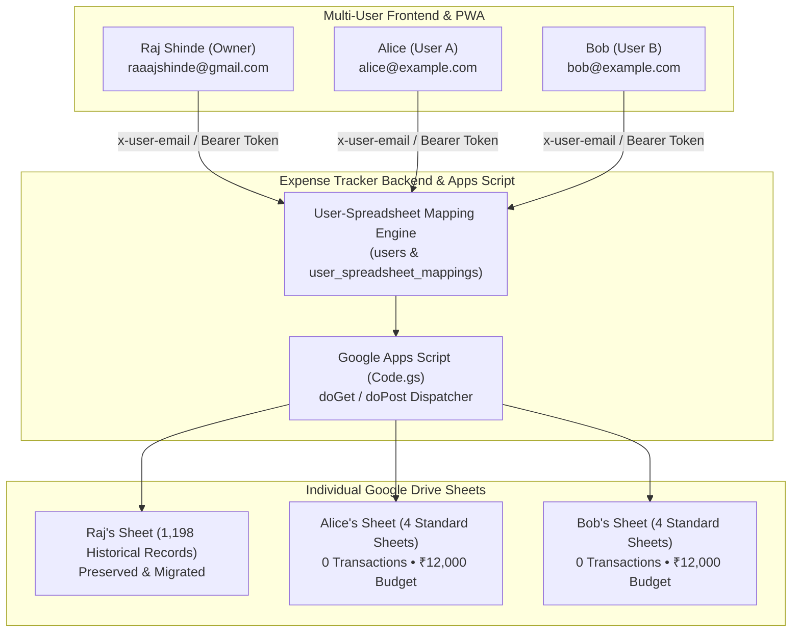

# Google Apps Script & Google Sheets Integration Guide (Multi-User Edition)

This guide explains how the Personal Expense Tracker manages individual, isolated Google Sheets for multiple users, with automatic spreadsheet provisioning and real-time two-way synchronization.

---

## Architecture Overview



- **Frontend:** Hosted on GitHub Pages (or run locally). Every user signs in via Google OAuth.
- **Backend:** Google Apps Script (`Code.gs`) or Node.js server. Validates user tokens and maps each user to their specific Google Spreadsheet ID.
- **Database:** Each user owns their own private Google Sheet in their Google Drive.
- **Data Isolation:** User A can never see or modify User B's spreadsheet. Raj's 1,198 historical transactions remain permanently preserved and isolated.

---

## Master Spreadsheet Template (4 Standard Sheets)

When a new user signs in for the first time, a new Google Sheet is created in their Google Drive with the standard template:

### 1. `Expenses` Sheet
Primary transaction records table:
- Column A: `Transaction_ID` (Unique ID, e.g. `TX-1718000000000-123`)
- Column B: `Date` (YYYY-MM-DD)
- Column C: `Description`
- Column D: `Category`
- Column E: `Payment Mode` (UPI, Cash, Credit Card, Debit Card, Net Banking)
- Column F: `Amount` (INR ₹, negative values for refunds)
- Column G: `Month_Key` (YYYY-MM)
- Column H: `Updated_At` (ISO 8601 timestamp)
- *Formatted with purple header background (`#371485`) and frozen top row.*

### 2. `Dashboard` Sheet
Calculated metrics and formulas:
- User Account (verified Google email)
- Monthly Budget (default: ₹12,000)
- Total Spent (`=SUM(Expenses!F2:F)`)
- Remaining Budget (`=B3-B4`)
- Template Version (`4.0.0`)

### 3. `Categories` Sheet
Master list of all 67 standard expense categories with icon names, hex color accents, and Quick Category flags.

### 4. `Payment_Modes` Sheet
Standard payment modes (`UPI`, `Cash`, `Credit Card`, `Debit Card`, `Net Banking`) with descriptions.

---

## Deployment & Setup Instructions

### Option A: Standalone Google Apps Script (Multi-User Web App)

1. Open Google Drive (or any Google Sheet), click **Extensions** > **Apps Script**.
2. Copy the entire contents of [google-apps-script/Code.gs](file:///d:/Expense%20Tracker/google-apps-script/Code.gs) into the editor.
3. Configure your shared secret:
   ```javascript
   var AUTH_SECRET = "ET_SECURE_SYNC_KEY_2026";
   ```
4. Click **Deploy** > **New deployment**:
   - Type: **Web app**
   - Execute as: **Me**
   - Who has access: **Anyone**
5. Click **Deploy** and authorize spreadsheet permissions.
6. Copy the generated **Web App URL** and enter it into the app's Settings under **Sheets Sync**.

### Option B: Automatic Direct Drive Creation (`drive.file` Scope)

1. When a user logs in with their Google Account on the app:
2. The app requests the least-privilege OAuth scope:
   `https://www.googleapis.com/auth/drive.file`
   *(This gives the app access ONLY to spreadsheets created by the app, never the user's entire Drive).*
3. The app initializes the 4-sheet template in the user's Drive.
4. The spreadsheet ID is securely registered in the backend `user_spreadsheet_mappings` table.
5. Future logins load the exact same spreadsheet automatically without duplicate creation.

---

## Historical Account Migration (Raj Shinde)

- Account: `raaajshinde@gmail.com`
- Spreadsheet ID: `1x-master-raj-expenses-sheet-2026`
- Status: `migrated`
- Historical records: 1,198+ transactions safely retained in SQLite and mapped to `user_id = 1`.
- Budget: Preserved at ₹12,000 INR.

---

## API Endpoints Supported by `Code.gs`

| Action | Parameters | Description |
| :--- | :--- | :--- |
| `ping` | `auth_secret`, `spreadsheet_id` | Verifies connection and returns spreadsheet metadata |
| `createSpreadsheet` | `title`, `user_email`, `default_budget` | Creates brand new 4-sheet template in Drive |
| `getExpenses` | `spreadsheet_id` | Returns all transaction rows from the user's Expenses sheet |
| `addExpense` | `spreadsheet_id`, `expense` | Inserts a new expense row |
| `updateExpense` | `spreadsheet_id`, `id`, `expense` | Updates an existing expense row by Transaction_ID |
| `deleteExpense` | `spreadsheet_id`, `id` | Removes an expense row by Transaction_ID |
| `twoWaySync` | `spreadsheet_id`, `client_changes`, `last_sync_time` | Batch synchronization and conflict reconciliation |
| `getMetadata` | `spreadsheet_id` | Returns sheet count, record counts, and last modified timestamps |
